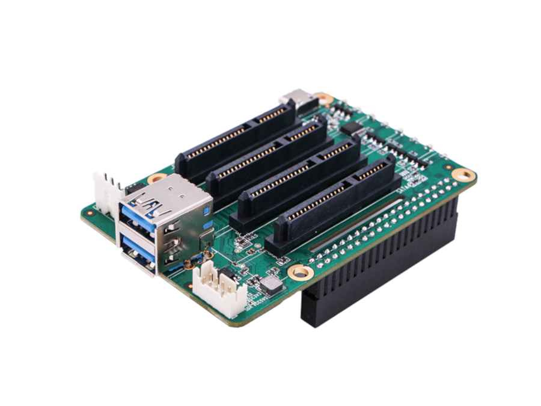

# ROCK Pi Quad SATA

[Quad SATA HAT wiki](<https://wiki.radxa.com/Dual_Quad_SATA_HAT>)

## Installation

```bash
sudo apt update
sudo apt install raspi-config python3-dev python3-rpi.gpio
wget https://github.com/radxa/rockpi-quad/releases/download/0.4.0/rockpi-quad.deb
sudo apt install -y ./rockpi-quad.deb
```

## Build

The `.deb` is built from the `rockpi-quad/` tree, for example right on the board:

```bash
git clone https://github.com/radxa/rockpi-quad.git
cd rockpi-quad
dpkg-deb --root-owner-group --build -Z gzip rockpi-quad
sudo apt install -y ./rockpi-quad.deb
```

Every push to the repository also builds the package via GitHub Actions (see the workflow artifacts).

[Penta SATA HAT docs](https://docs.radxa.com/en/accessories/penta-sata-hat)


